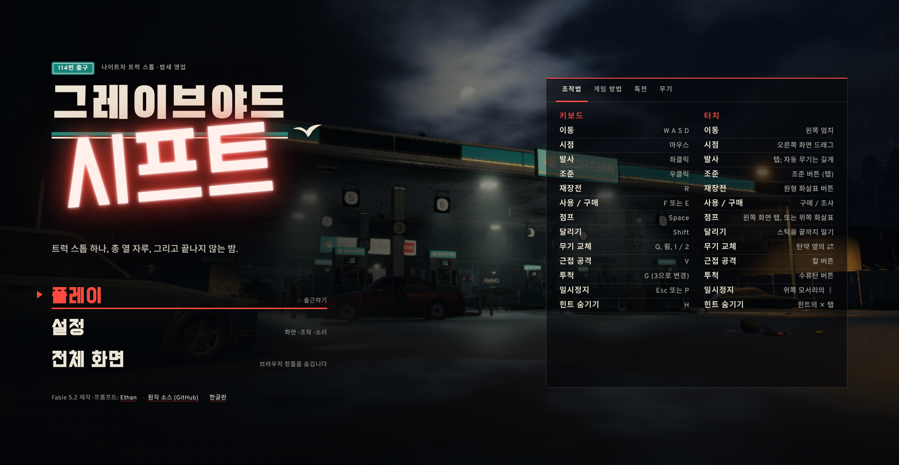
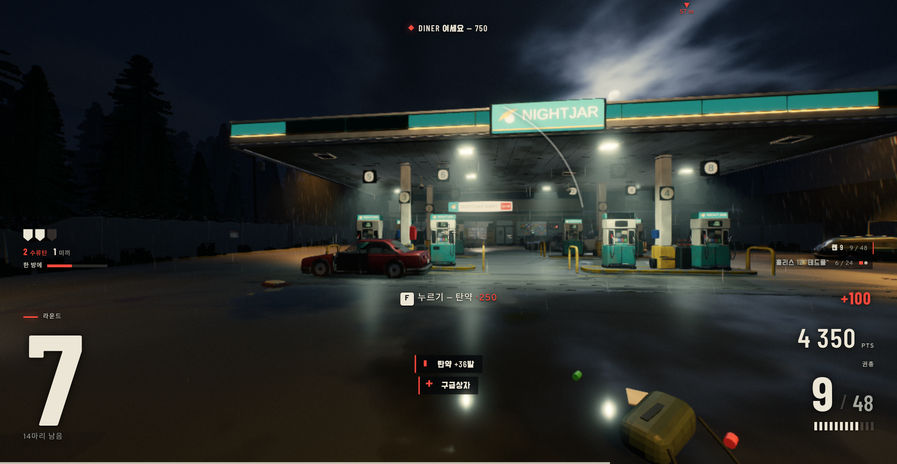
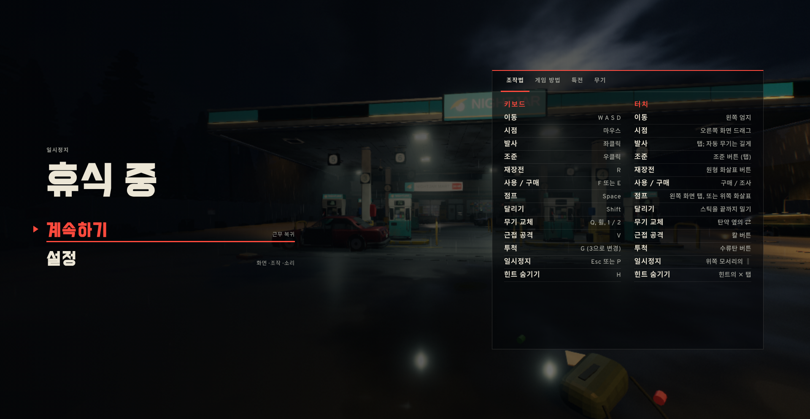
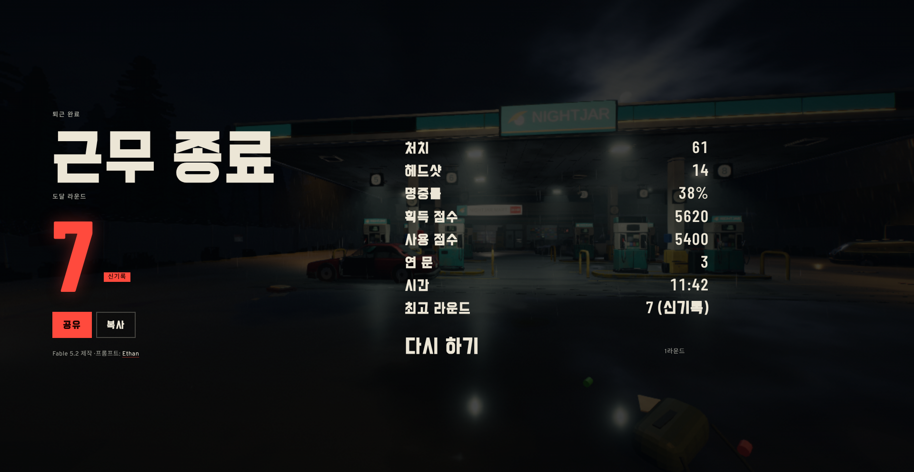
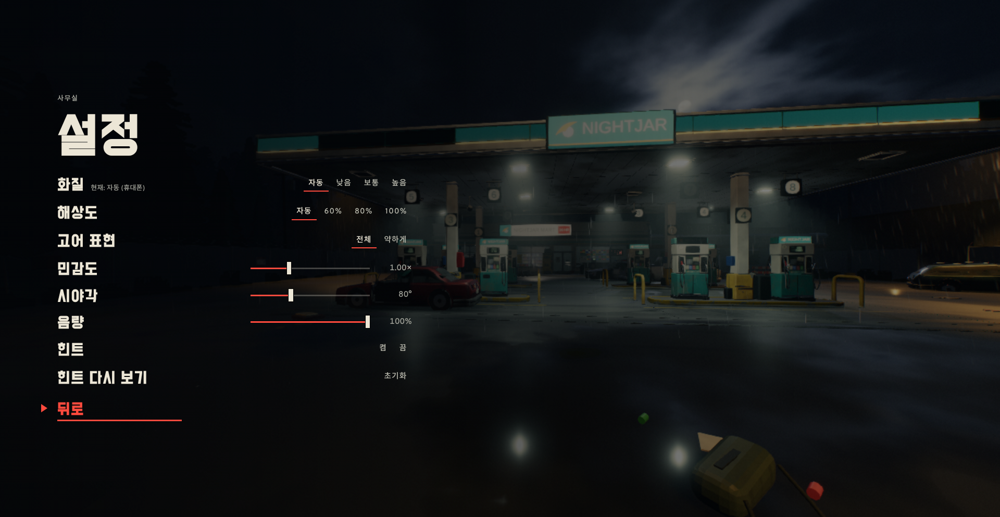
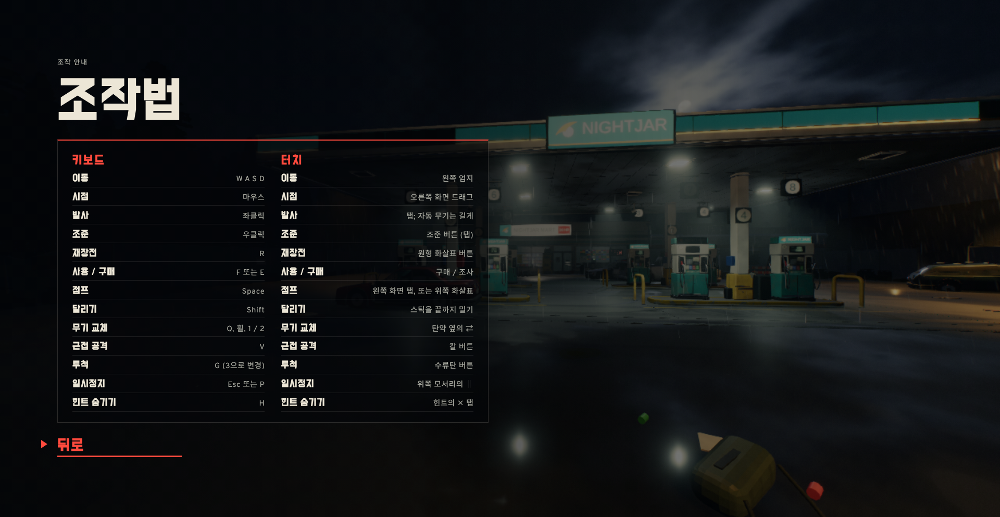
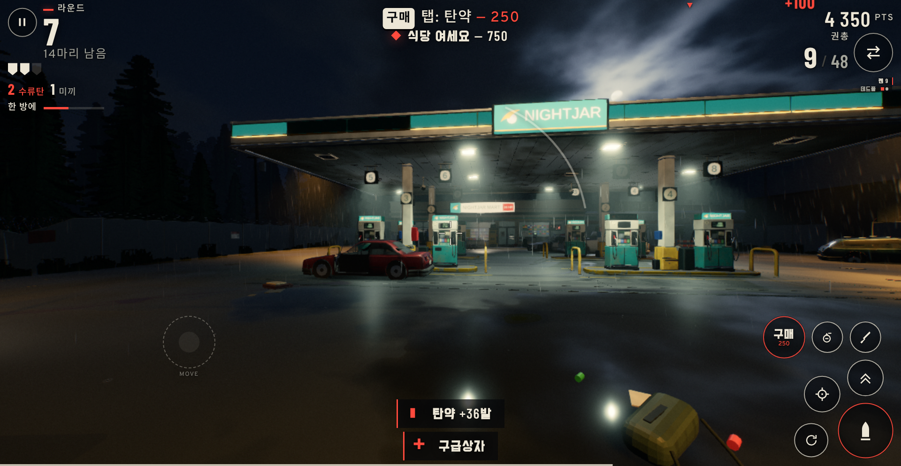

# 그레이브야드 시프트 (Graveyard Shift) 한글판

라운드제 좀비 슈터 **Graveyard Shift**의 한국어 번역판입니다. 밤새 길가 식당과 주유소를 지키며
판자를 못 박고, 명중·처치마다 점수를 벌고, 새 구역을 열고, 벽에 걸린 무기를 사고, 전리품을 찾고,
전원을 복구하세요. 라운드가 지날수록 좀비는 더 많고 더 강해집니다.
데스크톱에서는 마우스와 키보드로, 휴대폰에서는 터치로 플레이할 수 있습니다.


지금 플레이: **https://sigco3111.github.io/zombies-ko/**

원작: https://github.com/ethanplusai/zombies · 라이브: https://zombies.ethanplus.ai

## 스크린샷

| 타이틀 | 플레이 HUD |
| --- | --- |
|  |  |

| 일시정지 | 라운드 종료 |
| --- | --- |
|  |  |

| 설정 | 조작법 |
| --- | --- |
|  |  |

| 모바일 터치 HUD |
| --- |
|  |

## 한글판 특징

- 메뉴, HUD, 힌트, 목표 안내, 로딩 화면, 오류 메시지까지 게임 내 모든 인터페이스를 한국어로 옮겼습니다.
- 제목 워드마크를 한글 디자인(Black Han Sans, Do Hyeon)으로 새로 잡았고, 본문에는 Noto Sans KR을 씁니다.
- 총기 이름은 음차(렌 9, 홀리스 12, 콜더 556 …), 업그레이드 별명과 특전·파워업은 의미를 살려 번역했습니다.
- 간판·번호판처럼 3D 장면에 질감으로 구워진 영문 글자는 원작의 분위기를 해치지 않도록 그대로 두었습니다.
- 리더보드와 문제 신고 같은 온라인 기능은 원작과 같은 조건(별도 백엔드 설정)에서만 켜집니다.

## 실행하기

Node.js 22 이상이 필요합니다.

```sh
git clone https://github.com/sigco3111/zombies-ko.git
cd zombies-ko
npm install
npm run build        # dist/index.html 생성
```

`dist/index.html`을 브라우저로 열면 바로 실행됩니다. `npm run dev`는 변경 때마다 다시 빌드합니다.

테스트:

```sh
npm test             # Vitest 1546개
```

## 작동 방식

- [three.js](https://threejs.org) WebGL2 렌더링, 기기에 맞춰 화질 단계를 조절합니다.
- 모델, 텍스처, 애니메이션, 합성 오디오까지 모두 페이지 로딩 때 코드로 생성합니다.
  이미지 파일은 로딩 화면과 링크 미리보기용 키 아트뿐입니다.
- esbuild가 게임 전체를 하나의 HTML 파일(`dist/index.html`)로 묶어 어떤 정적 호스트에서도,
  심지어 디스크에서 바로 열어도 동작합니다.
- 리더보드와 "문제 신고" 폼은 선택 사항으로, [`server/`](server/README.md)의 Cloudflare Worker +
  D1 백엔드를 빌드에 설정(`GS_API_BASE`, `GS_ALLOWED_ORIGINS`)해야 켜집니다.

## 프로젝트 구조

| 폴더 | 내용 |
| --- | --- |
| `src/audio/` | 합성 효과음, 음성, 앰비언스, 음악 |
| `src/core/` | 게임 루프, 이벤트, 기기 감지, 저장, 시드 난수, URL 파라미터 |
| `src/fx/` | 파티클, 피, 데칼, 총구 화염, 불 등 효과 |
| `src/game/` | 규칙: 라운드, 경제, 구매, 파워업, 전리품, 기계, 튜닝 값 |
| `src/level/` | 맵: 배치, 건물, 소품, 차량, 충돌 |
| `src/mats/` | 절차적 재질과 텍스처 |
| `src/nav/` | 좀비 경로 탐색용 내비게이션 그리드와 플로 필드 |
| `src/net/` | 선택적 백엔드용 리더보드·신고 클라이언트 |
| `src/player/` | 이동, 시점, 입력, 터치 조작, 테스트 봇 |
| `src/render/` | 렌더러, 조명, 그림자, 하늘, 후처리, 화질 단계 |
| `src/ui/` | 메뉴, HUD, 로딩 화면, 힌트, 종료 화면, 리더보드, 신고 화면 |
| `src/weapon/` | 무기: 모델, 애니메이션, 발사, 1인칭 뷰 |
| `src/zombie/` | 좀비 몸체, 애니메이션, AI, 스폰 |
| `server/` | 리더보드·신고용 선택적 Cloudflare Worker |
| `scripts/` | 빌드, 스모크 테스트, 스크린샷, 벤치마크 스크립트 |
| `tests/` | Vitest 단위 테스트 |

## 크레딧

- 원작: **Graveyard Shift** — Built by Fable 5.2, prompted by [Ethan](https://x.com/ethanplusai)
  ([ethanplusai/zombies](https://github.com/ethanplusai/zombies))
- 한글화: [sigco3111](https://github.com/sigco3111) with Instinct (2026)

## 라이선스

원작과 동일하게 [MIT](LICENSE)입니다.
